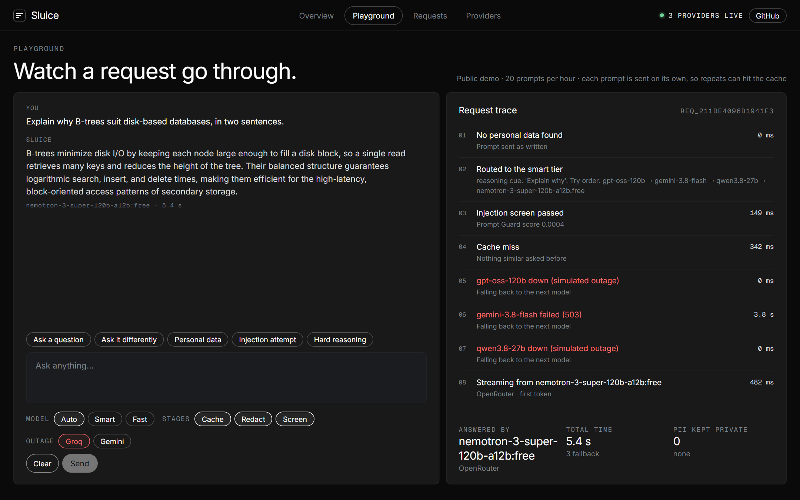
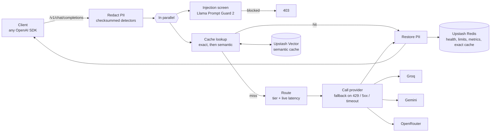
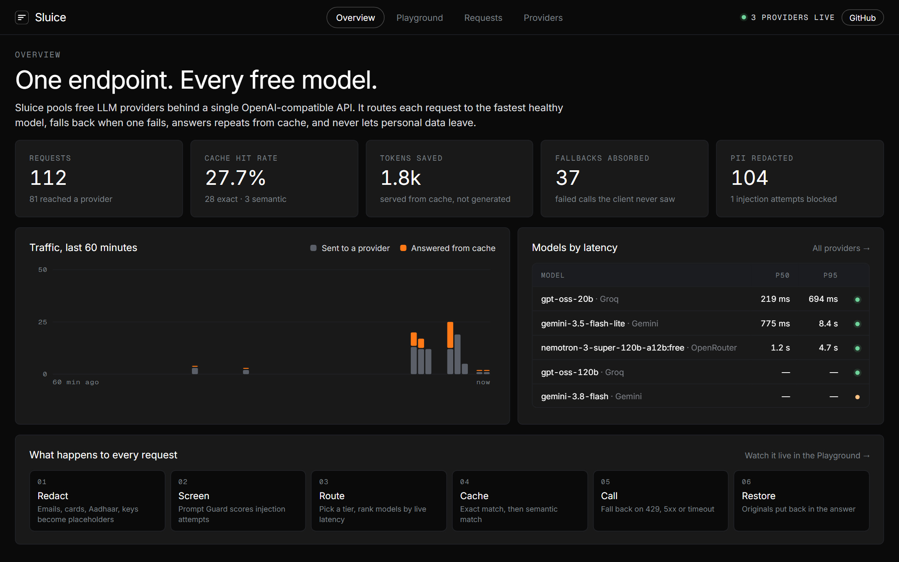
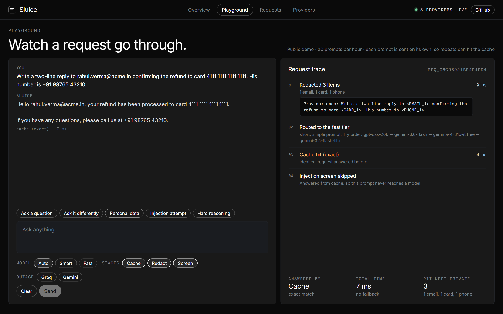
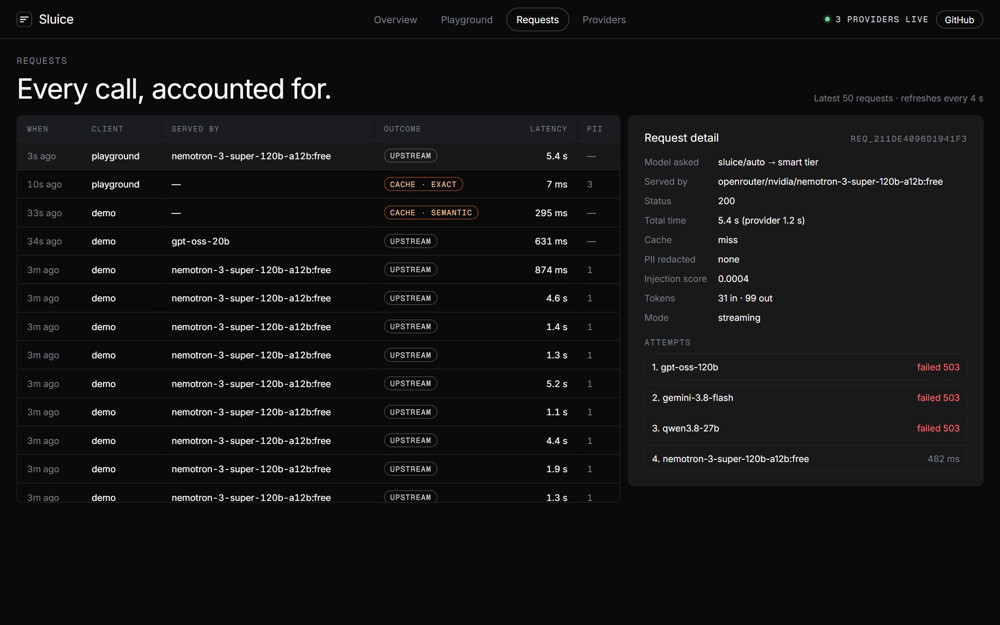
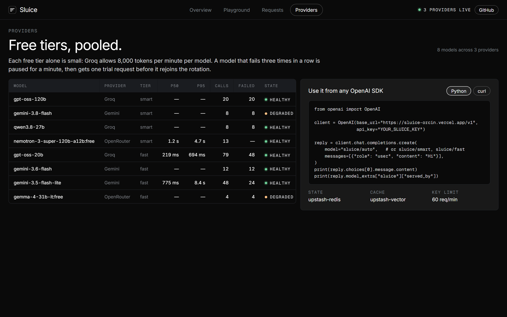

<p align="center">
  
</p>

<p align="center">
  <a href="https://sluice-orcin.vercel.app"></a>
</p>

<p align="center">
  
  
  
  
  
  
</p>

# Sluice

**Health-Aware LLM Routing with Semantic Caching and PII Redaction.** Sluice puts one OpenAI-compatible endpoint in front of several free LLM providers (Groq, Google Gemini, OpenRouter). Every request is screened for prompt injection, stripped of personal data, answered from cache when the question has been asked before, and otherwise routed to the fastest healthy model, with automatic fallback when a provider fails. Point any OpenAI SDK at it by changing one line.

**Live demo: https://sluice-orcin.vercel.app** · open the Playground, switch a provider off, and watch the request fail over.

<p align="center">
  <a href="https://sluice-orcin.vercel.app/#/playground"></a>
  <br><sub>A real request from the live demo: Groq switched off, Gemini 3.8 Flash overloaded (503), answered by OpenRouter.</sub>
</p>

## Results

Measured against the production deployment (Vercel + Upstash), timings from the gateway's own trace. Reproduce with [`bench/resilience.py`](bench/resilience.py).

| Scenario | Succeeded | p50 | p95 |
|---|---|---|---|
| Normal request (cache off) | 12 / 12 | 473 ms | 3.0 s |
| Cache hit | 12 / 12 | **8.5 ms** | 10.7 ms |
| Groq down | 12 / 12 | 901 ms | 3.5 s |
| Groq **and** Gemini down | 12 / 12 | 1.4 s | 4.9 s |

- **Gateway overhead:** 163 ms at p50. Most of it is the prompt-injection screen, which runs in parallel with the cache lookup and is skipped entirely on cache hits.
- **Semantic cache precision:** thresholds are calibrated per embedding model on 400 human-labelled [Quora Question Pairs](https://huggingface.co/datasets/nyu-mll/glue): about **92–93% of cache hits are true paraphrases**. The table below shows why the obvious default (0.95) would be wrong. Reproduce with [`bench/cache_eval.py`](bench/cache_eval.py).

| Threshold (gemini-embedding-2) | Hit precision | Paraphrases caught |
|---|---|---|
| 0.95 | 82.7% | 83.5% |
| **0.97 (used)** | **92.4%** | 48.5% |
| 0.98 | 95.5% | 31.5% |

A wrong cached answer is worse than a miss, so Sluice favours precision.

## Architecture



### How it works

**Routing.** `sluice/auto` picks a tier from the request itself: long prompts, code, reasoning cues ("explain why", "compare", "debug") or tool calls go to the *smart* tier, everything else to *fast*. Within a tier, models are ranked by an exponentially weighted average of their recent latency, so traffic drifts toward whatever is fastest right now. You can also ask for `sluice/smart`, `sluice/fast` or a concrete model (`groq/openai/gpt-oss-120b`), which keeps its tier as fallback.

**Resilience.** A 429, 5xx, timeout or dropped connection moves the request to the next model; a 400 does not (the request itself is wrong). A model that fails three times in a row is paused for 60 seconds (circuit breaker), then gets one trial request. Breaker state lives in Redis, so every serverless instance sees the same health. Streaming requests can fail over up to the first token.

**Semantic cache.** An exact-match lookup runs first (a hash of the redacted request). On a miss, the latest user message is embedded and compared with earlier questions *in the same scope*: same model tier, same system prompt, same prior turns, so "Answer in French" never returns an English answer. Only low-temperature requests without tools are cached. Free embedding quotas are counted per model, so the embedder falls back across three Gemini embedding models; each cache entry records which model embedded it, and only matches queries from that model at that model's calibrated threshold.

**PII redaction.** Emails, phone numbers, card numbers (Luhn-checked), Aadhaar (Verhoeff-checked), PAN, SSN, IBAN, IP addresses and API keys become typed placeholders (`<CARD_1>`) before the prompt leaves. The model answers in placeholders, and Sluice restores the originals on the way back, including inside streamed tokens split across chunks. The cache only ever stores redacted text.

**Tool calling across providers.** Requests that include tools only go to models with structured tool calling. When a fallback happens mid-conversation, the tool-call history is translated for the next provider (Gemini 3 needs a thought signature on every tool call; other providers reject Gemini's extra fields). A 400 that describes a model limitation rather than a bad request (a malformed tool call, a missing signature) moves to the next model without hurting the provider's health. [Triage](https://github.com/rohithprem18/triage) runs full tool-calling investigations through Sluice on this basis.

**Injection screening.** The latest user turn is scored by Meta's Llama Prompt Guard 2 (free on Groq). Scores of 0.9 and above are rejected with a 403 before any model sees them.

**Limits and telemetry.** Each client key gets its own per-minute limit; the public playground is limited per IP and per day. Every request is logged with its route, attempts, cache result, PII counts and tokens, and aggregated per minute for the console.

## Console

| | |
|---|---|
|  |  |
| **Overview:** requests, cache hit rate, tokens saved, fallbacks absorbed, traffic and model latency | **Playground:** the live request trace, including exactly what the provider saw |
|  |  |
| **Requests:** every call with its attempts, cache result and PII counts | **Providers:** per-model latency, health and circuit-breaker state |

## Use it

```python
from openai import OpenAI

client = OpenAI(base_url="https://sluice-orcin.vercel.app/v1", api_key="YOUR_SLUICE_KEY")
reply = client.chat.completions.create(
    model="sluice/auto",
    messages=[{"role": "user", "content": "Summarise RFC 9110 in one line."}],
)
print(reply.choices[0].message.content)
print(reply.model_extra["sluice"])   # served_by, cache, attempts, pii, latency, full trace
```

Streaming (`"stream": true`) returns standard SSE chunks; the final chunk carries the same `sluice` metadata.

| Header | Effect |
|---|---|
| `x-sluice-cache: off` | skip both caches for this request |
| `x-sluice-redact: off` | send the prompt unredacted |
| `x-sluice-guard: off` | skip the injection screen |
| `x-sluice-simulate-outage: groq,gemini` | treat those providers as down for this request (never affects shared health) |

Responses include `x-sluice-request-id`, `x-sluice-served-by`, `x-sluice-cache` and OpenAI-style `x-ratelimit-*` headers.

## Run locally

No Docker and no accounts needed for a first run: without Upstash keys Sluice keeps state in memory.

```bash
git clone https://github.com/rohithprem18/sluice.git && cd sluice
python -m venv .venv && source .venv/bin/activate      # Windows: .venv\Scripts\activate
pip install -r requirements-dev.txt
cp .env.example .env                                   # add at least GROQ_API_KEY or GEMINI_API_KEY
set -a && . ./.env && set +a
uvicorn sluice.app:app --port 8000                     # API on :8000

cd web && npm ci && npm run dev                        # console on http://localhost:5175
```

Or build the console once (`cd web && npm run build`) and uvicorn serves it at http://localhost:8000.

## Deploy (free)

1. Create a free [Upstash](https://console.upstash.com) Redis database and a Vector index (768 dimensions, cosine).
2. `npx vercel link`, then add the variables from [`.env.example`](.env.example) with `npx vercel env add NAME production`. Set `SLUICE_API_KEYS="app1:sk-...,app2:sk-..."` to require keys on `/v1`.
3. `npx vercel deploy --prod`. The console is served as static files and `/v1/*` and `/api/*` go to one Python function ([`vercel.json`](vercel.json)).

## Configuration

| Variable | Default | Purpose |
|---|---|---|
| `GROQ_API_KEY`, `GEMINI_API_KEY`, `OPENROUTER_API_KEY`, `CEREBRAS_API_KEY` | | Providers; any subset works |
| `UPSTASH_REDIS_REST_URL` / `_TOKEN` | memory | Shared state |
| `UPSTASH_VECTOR_REST_URL` / `_TOKEN` | memory | Semantic cache |
| `SLUICE_API_KEYS` | none (open) | `name:secret` pairs for `/v1` |
| `SLUICE_CACHE_THRESHOLD` | per model | Overrides the calibrated thresholds |
| `SLUICE_CACHE_MAX_TEMPERATURE` | 0.5 | Hotter requests are never cached |
| `SLUICE_KEY_RPM` | 60 | Requests per minute per key |
| `SLUICE_PLAYGROUND_PER_HOUR` / `_PER_DAY` | 20 / 400 | Public demo limits |
| `SLUICE_GUARD` / `SLUICE_GUARD_THRESHOLD` | 1 / 0.9 | Injection screen |
| `SLUICE_BREAKER_FAILURES` / `_COOLDOWN_S` | 3 / 60 | Circuit breaker |

## Project layout

```
sluice/
├── sluice/
│   ├── app.py          # FastAPI: /v1 (OpenAI-compatible), console API, local static serving
│   ├── gateway.py      # the pipeline: redact → (screen ∥ cache) → route → call/fallback → restore
│   ├── router.py       # tiers, latency EWMA, circuit breakers
│   ├── providers.py    # provider catalog + OpenAI-compatible client (JSON and SSE)
│   ├── cache.py        # exact + semantic cache, per-model thresholds
│   ├── embeddings.py   # Gemini embedding chain with quota fallback
│   ├── pii.py          # detectors, reversible placeholders, stream restorer
│   ├── guard.py        # Llama Prompt Guard 2 screen
│   ├── limits.py       # fixed-window rate limits
│   ├── metrics.py      # per-minute counters, latency samples, request log
│   └── store.py        # Upstash REST client (pipelined) + in-memory stand-in
├── api/index.py        # Vercel entry point
├── web/                # React + Vite console
├── bench/              # cache calibration and resilience benchmarks, with results
└── tests/              # 38 tests: scripted providers, fake embedder, no network
```

## Development

```bash
pytest -q && ruff check .          # backend
cd web && npm run build            # type-check + build the console
```

CI runs both on every push.

## Used by

- [Quarry](https://github.com/rohithprem18/quarry): Text-to-SQL on BIRD, every model call through Sluice.
- [Triage](https://github.com/rohithprem18/triage): tool-calling incident-response agent.

## Limitations

- Free tiers are small and change without notice. Groq allows 8,000 tokens per minute per model, Gemini embeddings 1,000 requests per day per model, and OpenRouter's free models share a pool that is sometimes rate limited. Sluice exists because of this, but it cannot create capacity that isn't there.
- The semantic cache trades recall for precision: about half of genuine paraphrases still miss. Even at the chosen threshold, roughly 1 in 13 hits on the adversarial QQP pairs is not a true duplicate. Keep the cache off for requests where a near-miss answer is unacceptable.
- Redaction is pattern-based. It catches structured identifiers reliably, but not names or free-text addresses.

## License

MIT
